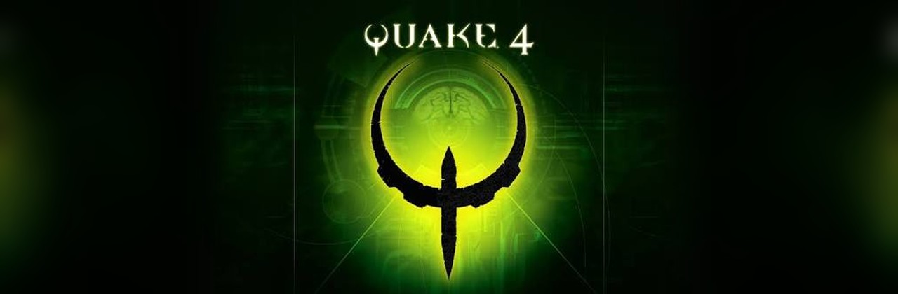

<div align="center">



# Quake4NX

**Quake 4 on Nintendo Switch**

Unofficial Nintendo Switch port of **Quake 4** (2005), single player and multiplayer, built on the
[openQ4](https://github.com/themuffinator/openQ4) source port, with a native
[deko3D](https://github.com/devkitPro/deko3d) renderer.

[](#)
[](#)
[](https://github.com/hazevauks/Quake4NX/releases)
[](docs/architecture.md)
[](#)
[](LICENSING.md)

</div>

---

> [!WARNING]
> Work in progress. It runs on a PC test rig with real game files, but has not been run on a console yet. See [Status](#status).

This repository has no game files. You need your own copy of Quake 4.

## What you need

- A Switch with Atmosphère and [sphaira](https://github.com/ITotalJustice/sphaira)
- Your own copy of **Quake 4**, patched to 1.4.2 (the GOG and Steam versions are)
- About 3 GB free on the SD card

On a PC, for the first install: Python 3.

## Installing

1. Take `Quake4NX.zip` from the [releases](https://github.com/hazevauks/Quake4NX/releases), and extract it. It holds `switch/quake4/quake4.nro` and openQ4's `baseoq4/pak0.pk4` and `baseoq4/mod.json`.
2. Check your game files and copy them next to it:

   ```bash
   python tools/make_sd.py "<folder with q4base>" --nro switch/quake4/quake4.nro --pak0 switch/quake4/baseoq4/pak0.pk4
   ```

3. Copy what is inside `SD_CARD/` to the root of your SD card.
4. Start **Quake 4** from the homebrew menu. It needs the full memory: start it through a forwarder or with title takeover, not from the album.

To update, replace `quake4.nro` in `sd:/switch/quake4/`.

## Controls

| Switch | Game |
| --- | --- |
| Left stick | move |
| Right stick | look |
| ZR | fire |
| ZL | zoom |
| B | jump |
| A | crouch |
| Y | reload |
| X | flashlight |
| L | weapon wheel, held, with the right stick |
| R | last weapon |
| D-pad right / left | next / previous weapon |
| D-pad up | objectives, or scores |
| D-pad down | quick chat, in multiplayer |
| Left stick click | run |
| Right stick click | center the view |
| + | menu |
| − | scores or objectives, held |
| + and − together | console |

In menus A confirms and B goes back, the D-pad or the left stick moves, L and R change tabs, and ZL and ZR change sections. The touch screen works too. Vehicles drive and fire with the same controls.

Gyro aiming is off by default: turn it on with `in_gyro 1`, and set its strength with `in_gyroSensitivity`.

Every action can be changed in the menu's controls, or with `bind` in the console, for example `bind JOY5 _impulse13`. `JOY1` to `JOY16` are L, R, B, A, X, Y, +, −, D-pad up, down, right and left, the two stick clicks, ZR and ZL.

## Logs

The game writes to `sd:/switch/quake4/SD_LOG/`:

| File | What it is |
| --- | --- |
| `quake4_log.txt` | everything the game printed (`quake4_log_previous.txt` is the last run) |
| `quake4_crash.txt` | a crash: the address, the call stack, the registers |
| `quake4_fatal.txt` | a fatal error's message |

Copy them to `SD_LOG/` in this repository to look at them. For a live log, start the game with `nxlink -s quake4.nro`.

## Status

| Area | State |
| --- | --- |
| Builds (engine, both games, native renderer) | Works |
| Your game files, and openQ4's pack | Checked on a PC |
| Menus, HUD, saves, a local multiplayer server | Run on a PC test rig |
| Boots on a console | **Not tested yet** |
| Picture on the console's GPU, sound, vehicles | **Not tested yet** |
| 60 fps at 1020/460/1331 MHz | **Not measured yet** |

What has been checked and how is in [docs/status.md](docs/status.md).

## Building

With devkitPro's `switch-dev`, `deko3d`, `uam`, `switch-openal-soft`, `switch-sdl2` and `switch-zlib`, from its MSYS2 shell, or from the `devkitpro/devkita64` container:

```bash
./build.sh
```

The result is `build/quake4.nro`. How the port is put together is in [docs/architecture.md](docs/architecture.md), and how to test it is in [docs/testing.md](docs/testing.md).

## Credits

- [themuffinator](https://github.com/themuffinator) for openQ4, and those it credits in [CONTRIBUTORS.md](CONTRIBUTORS.md), among them Emile Belanger for the GLES renderer this one's passes were checked against
- id Software and Raven Software for the engine and the game
- [fincs](https://github.com/fincs) and the devkitPro team for deko3D, uam and libnx

The engine is under the GPLv3. The game code in `src/game` and `src/mpgame` comes from the Quake 4 SDK and is under its own license, which limits commercial use and distribution: see [LICENSING.md](LICENSING.md). Quake 4 is a trademark of its owners; this project is not affiliated with them.
